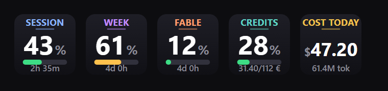
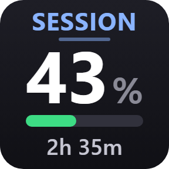
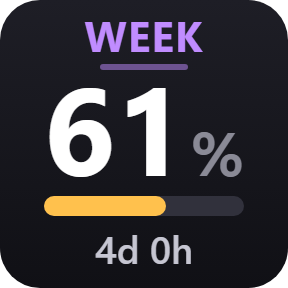
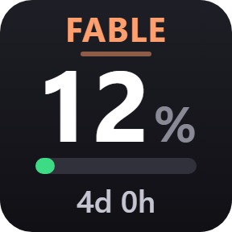
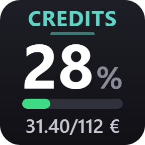
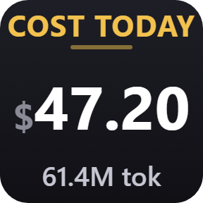

<div align="center">

# Claude Usage

### Stop guessing how much Claude you have left.

Session window, weekly cap, Fable budget, usage credits, and what today's tokens
would have cost — on five Stream Deck keys, refreshed every minute.

[](LICENSE)
[](https://github.com/karolpolikarp/claude-usage-streamdeck/stargazers)




<sub>Values are synthetic — the plugin renders your own.</sub>

**[Website](https://karolwilczynski.com/claude-usage-streamdeck/)** ·
[Install](#install) ·
[How it works](#how-it-works) ·
[Your data](#what-it-does-with-your-data)

</div>

---

## The five keys

<table>
<tr>
<td width="96"></td>
<td><b>Session</b> — the rolling 5-hour window, the one that bites during a long
working session. The bottom line counts down to the reset.<br>
<sub><code>five_hour.utilization</code></sub></td>
</tr>
<tr>
<td></td>
<td><b>Week</b> — the weekly cap across every model, so a heavy Monday shows up
before it costs you on Friday.<br>
<sub><code>seven_day.utilization</code></sub></td>
</tr>
<tr>
<td></td>
<td><b>Fable</b> — the model-scoped weekly window gets its own dial, because that
is the budget you actually ration.<br>
<sub><code>limits[]</code> where <code>scope.model.display_name = "Fable"</code></sub></td>
</tr>
<tr>
<td></td>
<td><b>Credits</b> — usage-credit spend in your own currency. The caption greys
out when credits are switched off, so the balance stays readable.<br>
<sub><code>spend</code>, falling back to <code>extra_usage</code></sub></td>
</tr>
<tr>
<td></td>
<td><b>Cost today</b> — today's tokens priced at API list rates, cache writes and
reads counted separately. Nothing is billed on a subscription; it is a measure of
effort.<br>
<sub><code>~/.claude/projects/**/*.jsonl</code></sub></td>
</tr>
</table>

The bar carries the severity colour — green below 50%, amber below 75%, orange
below 90%, red above — so you read the colour before you read the number.
Pressing a key forces a refresh. Data older than five minutes goes grey with an
amber dot.

Type is sized to the key rather than to a fixed scale: the renderer estimates
width glyph by glyph and picks the largest size that fits, so a long value
shrinks instead of spilling over the edge. Keys are 72×72 physical pixels, which
is why the layout carries very little besides the number.

## Install

Needs **Stream Deck 6.5+** — the plugin runs on the Node 20 runtime the app
already ships with, so nothing has to be on your `PATH` — and **Claude Code,
logged in**. Node.js is only used to install the one dependency and run the dev
tools.

```bash
git clone https://github.com/karolpolikarp/claude-usage-streamdeck.git
cd claude-usage-streamdeck
npm install --prefix com.karolp.claudelimits.sdPlugin
```

```powershell
# Windows — copies the plugin and restarts Stream Deck
.\deploy.ps1
```

<details>
<summary><b>macOS</b></summary>

```bash
cp -R com.karolp.claudelimits.sdPlugin \
  ~/Library/Application\ Support/com.elgato.StreamDeck/Plugins/
```

Then restart Stream Deck. Developed and tested on Windows — the plugin code is
platform-neutral, but only the Windows install path is exercised.

</details>

Then drag **Session (5h)**, **Week (all models)**, **Fable (weekly)**, **Usage
credits**, and **Cost today** from the **Claude** category onto keys. An action
that is only opened in the action list is not running — it has to sit on a key.

## How it works

### The four limit keys

`GET https://api.anthropic.com/api/oauth/usage`, authenticated with the OAuth
access token from `~/.claude/.credentials.json` — the same endpoint and the same
file Claude Code's own `/usage` command uses. One request a minute serves all
four keys, and it is only made when at least one of them is on a profile.

When the stored token has expired, or the API answers `401`, the plugin refreshes
it against `https://platform.claude.com/v1/oauth/token` and **writes the new
tokens back**, so Claude Code and the plugin stay on the same credentials. The
previous file is kept as `.credentials.json.sdbak`.

A `429` is honoured rather than retried blindly: the plugin reads `retry-after`,
schedules one retry, and suppresses its own minute timer for that window so it
does not add traffic while rate limited.

### Cost today

This one never touches the network. It reads the assistant entries in
`~/.claude/projects/**/*.jsonl` whose `timestamp` falls on the current local day
and prices `message.usage` against the rates in [`bin/pricing.js`](com.karolp.claudelimits.sdPlugin/bin/pricing.js):

| Model | Input $/MTok | Output $/MTok |
| --- | ---: | ---: |
| `claude-fable-5` | 10 | 50 |
| `claude-opus-5`, `claude-opus-4-8`, `claude-opus-4-7` | 5 | 25 |
| `claude-sonnet-5`, `claude-sonnet-4-6` | 3 | 15 |
| `claude-haiku-4-5` | 1 | 5 |

Cache tokens are priced off the input rate: 5-minute write ×1.25, 1-hour write
×2, read ×0.1. `cache_creation.ephemeral_5m_input_tokens` and
`ephemeral_1h_input_tokens` are counted separately. A model with no rate entry
contributes nothing and is counted in `unpricedRequests`.

Two details that matter for correctness:

- Transcripts repeat the same assistant message several times under one
  `requestId` as the response grows, so entries are **keyed and overwritten
  rather than summed**. Summing inflates the total several-fold.
- Files are read **incrementally from the last byte offset**. The first scan of a
  day reads every file touched today (~17 MB / 220 ms on the author's machine);
  later polls read only the new bytes (~40 ms). State is in memory, so restarting
  Stream Deck triggers one full rescan.

## What it does with your data

It reads your credentials, so this section is the important one.

| | |
| --- | --- |
| **network** | Two hosts, nothing else. Anthropic's API for usage, and the token endpoint when a refresh is due. No telemetry, no analytics, no third parties. |
| **transcripts** | Message content is never read. The cost scan pulls token counts and timestamps out of the JSONL and nothing else, and it never leaves your machine. |
| **credentials** | Written back only on expiry, atomically, keeping the previous file as `.credentials.json.sdbak`. |
| **audit** | Six files, no build step, one dependency — [read it in a sitting](com.karolp.claudelimits.sdPlugin/bin). |

## Layout

```
com.karolp.claudelimits.sdPlugin/
  manifest.json          5 actions, Node 20 runtime
  bin/plugin.js          WebSocket wiring, polling, key updates
  bin/usage.js           credentials, token refresh, /api/oauth/usage
  bin/cost.js            incremental transcript scan
  bin/pricing.js         per-model rates and cache multipliers
  bin/render.js          SVG key images
  bin/log.js             rolling log
  imgs/                  static manifest icons
docs/                    landing page, published with GitHub Pages
tools/                   dev helpers, see below
deploy.ps1               install into Stream Deck and restart it
```

## Development

Everything can be exercised without touching the hardware.

| Command | What it does |
| --- | --- |
| `node tools/simulate.js` | Fake Stream Deck host — opens a WebSocket server, spawns `bin/plugin.js` with the arguments Stream Deck passes, sends `willAppear` for every action, and writes out whatever the plugin draws. |
| `node tools/preview.js` | Renders the keys to `preview/*.svg` with live values. `--demo` uses fixed values including the stale and error states. |
| `node tools/cost-check.js` | Today's cost roll-up per model, with cold and incremental scan timings. |
| `node tools/test-writeback.js` | Credentials write-back safety check, against a throwaway copy. |
| `node tools/make-icons.js` | Regenerates `imgs/actions/*-key.svg` from the renderer. |
| `node tools/make-docs-image.js` | Rebuilds the landing-page and readme artwork from synthetic values. |

## Troubleshooting

`plugin.log` in the installed plugin folder
(`%APPDATA%\Elgato\StreamDeck\Plugins\com.karolp.claudelimits.sdPlugin\` on
Windows) records every poll and error.

| Key shows | Meaning |
| --- | --- |
| `!` `no login` | `.credentials.json` is missing or has no OAuth block — run `claude` once and log in |
| `!` `auth` | the refresh token was rejected; log in again |
| `!` `slow down` | the usage endpoint returned `429`; the plugin backs off and retries |
| `!` `offline` | network error reaching the API |
| `--` `no data` | no poll has succeeded yet |
| `0%` `unused` | the window exists but has not been touched this period |

A key that never leaves `--` usually means the action is not actually on a key.
Each placed key logs a `willAppear` line, and the poll line names only the
sources it had a key for (`usage`, `cost`).

---

<div align="center">
<sub>MIT — see <a href="LICENSE">LICENSE</a> · Not affiliated with Anthropic or Elgato</sub>
</div>
